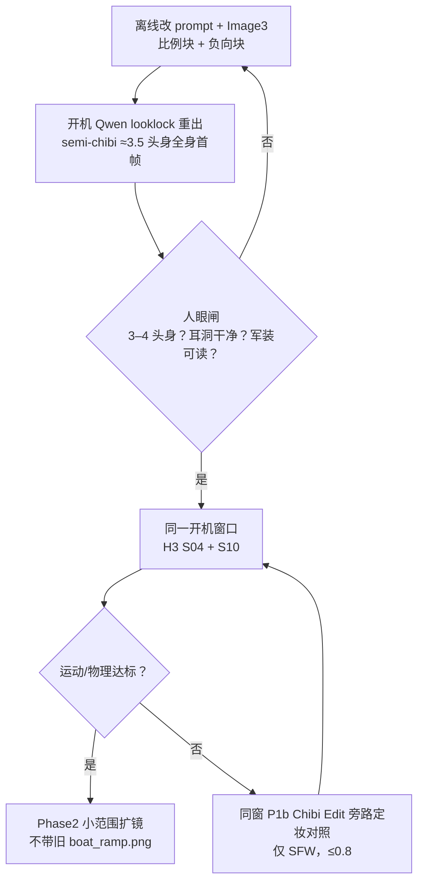

# 社区检索 · 更可爱、少「细高条」（真宠→猫拟人静帧→图生视频 · SFW · 2026-10-27）

> 用户 **t70u**。本文只读公开社区页面与既有本仓文档；对照 [`COMFY-CAT-ANTHRO-COMMUNITY-2026-10-25.md`](COMFY-CAT-ANTHRO-COMMUNITY-2026-10-25.md)、[`COMMUNITY-LOOKLOCK-2026-10-24.md`](COMMUNITY-LOOKLOCK-2026-10-24.md)、[`LOCAL-H3-PLAN-v0.3-2026-10-27.md`](LOCAL-H3-PLAN-v0.3-2026-10-27.md)、[`SELF-REVIEW-H3-SMOKE-2026-10-27.md`](SELF-REVIEW-H3-SMOKE-2026-10-27.md)、[`MAJOR-LEAP-PLAN-v0.2-2026-10-26.md`](MAJOR-LEAP-PLAN-v0.2-2026-10-26.md)；样片锚点 `outputs/h3-smoke-2026-10-27/`。
> **边界**：SFW；禁 NSFW / 去衣 / 未成年性化；禁 grok / grok.com CLI；未开机、未下载新权重、未 merge。Civitai / Hugging Face / RunningHub 的许可证与训练集**未逐项人工复核**，落地前须 vet。

## §0 结论先行

1. **可爱与体型几乎全靠首帧 looklock**；H3 I2V 会继承 first frame 的头身比 → **先改静帧，再进 Phase2**（即 Opus 选项 C）。
2. **默认目标 = semi-chibi / 约 3–4 头身**；不要写实 7–8 头身；也不要默认全片 2 头身超 Q（军装可读性会崩）。
3. **looklock 正向追加**：`semi-chibi proportions, roughly 3.5-head-tall, large round head, short thick limbs, soft fluffy volume, chubby cheeks, big expressive eyes, slight blush, compact torso`。
4. **负向追加**：`skinny, lanky, elongated limbs, long thin legs, fashion-model proportions, tall thin, wasp waist, spindly`。
5. **参考图**：Image1 真猫不变；Image2 军装选**宽松圆肩**；Image3 = **半 Q 直立拟人比例 mood**；H3 可选 **Ref2VA** 含**全身比例图**；turbo 弱参考 → **终渲 20–25 step**；可选 **SFW Animal→Human / Chibi Edit LoRA** 强度 **0.6–0.8** 起。

**默认推荐（一句）**：下一开机窗前，用 Qwen looklock 重出 **semi-chibi（约 3.5 头身）美军小橘全身首帧**，再同一窗口用该首帧跑 **H3 S04+S10**；**不靠 H3 风格 LoRA「救」细高条**。

> **旁注（t72u）**：静帧默认已改 **Cursor GenerateImage**；本句的 Qwen looklock 仅作可选对照。已入库 5 张首末帧见 [`outputs/cursor-stills-2026-10-27/`](../outputs/cursor-stills-2026-10-27/) 与 [`CURSOR-STILLS-2026-10-27.md`](CURSOR-STILLS-2026-10-27.md)。

**备选（一句）**：若仍偏写实条 → 同窗加 **Qwen Edit Chibi / 潮玩手办 LoRA 旁路定妆对照**（仅 SFW；强度 ≤0.8）。

## §1 问题对齐表

| 观感问题 | 真正根因 | 本岗动作 | 不做什么 |
| --- | --- | --- | --- |
| 「不可爱、细高条」 | 首帧就是写实 7–8 头身；I2V 只会继承 | 重出 semi-chibi（约 3.5 头身）全身首帧；正/负向写死比例 | 不指望 H3 风格 LoRA 拉回头身比 |
| 钢盔耳洞 / 局部身份 | 首帧耳洞与耳形不干净，I2V 放大瑕疵 | 定妆人眼闸看耳洞；必要时重抽首帧 | 不把耳洞问题带到全片 |
| 步态僵 | 首帧重心与动作可读性弱；prompt 只写「走」 | 首帧选重心明确、腿短而厚、迈步可读的姿态；prompt 写清方向与发力 | 不靠后期变速假装运动 |
| 军装与圆润冲突 | 军装默认收腰、硬肩、长大衣 | 选**宽松圆肩**、短版夹克、软质体积；半 Q 化 | 不穿紧身收腰时装化军装 |
| 全片风格漂移 | 每镜首帧比例不一 | 先锁定一张「比例锚」首帧，再派生 S04/S10 | 不带着现有细高 `boat_ramp.png` 扩全片 |

## §2 比例档位表

| 档位 | 头身比 | 可爱度 | 军装可读性 | 用途 | 结论 |
| --- | --- | --- | --- | --- | --- |
| 超 Q | 2–2.5 头身 | 最高 | 低（装备/动作易糊） | 表情包、贴纸、旁路测试 | **旁路**，不做全片默认 |
| **semi-chibi** | **3–4 头身** | **高** | **中高** | **本片默认** | **默认目标（约 3.5）** |
| 二次元 | 5–6 头身 | 中 | 高 | 风格化回退 | 回退档，不优先 |
| 写实 | 7–8 头身 | 低（当前「细高条」来源） | 最高 | 写实向项目 | **禁止默认** |

> 读法：头身比是**首帧产品参数**，不是 H3 采样参数。3.5 头身 ≈ 头高占全身约 2/7；可用「全身站直、脚到头完整入画」的参考图直接量。

## §3 社区来源表

| # | 来源 | 要点 | 本岗用法 / 风险 |
| --- | --- | --- | --- |
| 1 | [Civitai · ChibiStyleXL](https://civitai.com/models/123727/chibistylexl) | SDXL chibi 风格模型，trigger `chibi` | 旁路风格参照；**license 与训练集须 vet** |
| 2 | [Civitai · Pinkie Chibi Animals (Flux/SDXL)](https://civitai.com/models/653184/pinkie-chibi-animals-fluxsdxl) | 动物 chibi 化，强调动物特征保留 | 仅借「动物→chibi」思路；不直接换基座 |
| 3 | [Civitai · Q-Chibi Maker](https://civitai.com/models/1843233/q-chibi-maker) | big head / short body / big hands 的 Q 版公式 | 与 3.5 头身正向词同构；**license 须核** |
| 4 | [RunningHub · Qwen Edit 一键 Chibi](https://www.runninghub.cn/post/1980449032965435394) | Qwen Edit 工作流一键 chibi | 证明 Qwen Edit 路线可做 chibi 旁路；参数未公开需自测 |
| 5 | [Hugging Face · Qwen-Image-Edit-2511-Trendy_figurines](https://huggingface.co/starsfriday/Qwen-Image-Edit-2511-Trendy_figurines) | 潮玩/Q 版手办风，社区常用强度 **0.8–1.0** | P2 旁路；强度从 0.6–0.8 起测，避免塑料感 |
| 6 | [Hugging Face · Qwen-Edit-2509-Anishift-LoRA](https://huggingface.co/hiru13do37/Qwen-Edit-2509-Anishift-LoRA) | animal → human avatar | P1 Animal→Human 候选；**版本是 2509，须测 2511 兼容** |
| 7 | [RunningHub · Animal To Talking Human](https://www.runninghub.cn/post/1989526705981321218) | 已有 10-25 文档记录；动物拟人 + 说话视频 | 只借**静帧先拟人**；不引入说话/口型链路 |
| 8 | [Reddit · How do you get average proportions on women?](https://www.reddit.com/r/StableDiffusion/comments/1h1tez7/how_do_you_get_average_proportions_on_women/) | 社区负向：tall / lanky / skinny 等词会显著改体型 | 直接进 §4.2 负向块 |
| 9 | [Reddit · How to fit ControlNet stuck figures for chibi](https://www.reddit.com/r/StableDiffusion/comments/14fkg30/how_to_fit_control_net_stuck_figures_for_chibi/) | OpenPose 成人骨架直接套 chibi 会「拉长」 | 若上姿态控制，先缩放关键点，不套成人骨架 |
| 10 | [GitHub · ComfyUI_pose_inter](https://github.com/fssorc/ComfyUI_pose_inter) | Pose Modify，可改肢体长度/比例 | 可选姿态修正；非首轮必须 |
| 11 | [comfy.icu · ComfyUI-ProportionChanger](https://comfy.icu/extension/grmchn__ComfyUI-ProportionChanger) | 关键点缩放改比例 | 与 #10 同类；优先改首帧而非硬拉 I2V |
| 12 | [Turnaround Sheet · Character to Video (MiniMax H3)](https://turnaroundsheet.com/character-to-video/minimax-h3) | **Ref ≤9**；`full_body` 锁比例；turbo 属弱参考；风格 LoRA 约 **0.5** | H3 侧参数依据；turbo 出片不够就升 20–25 step |
| 13 | [Hugging Face · H3_Character_Sheet_Generator](https://huggingface.co/PoopMan333/H3_Character_Sheet_Generator) | H3 角色设定表生成 | 可做「全身比例图」参考；SFW 使用 |
| 14 | [GitHub · h3-studio](https://github.com/CharlesMod/h3-studio) | H3 Studio 工具链 | 仅旁证 H3 生态；本仓仍走 Comfy 内置节点 |
| 15 | [SeaArt · chibi + 军装示例](https://www.seaart.ai/explore/detail/cqhlrsle878c73cqo6h0) | chibi 与军装可并存 | 视觉参照：圆脸 + 宽松军装 |
| 16 | [Reddit · r/CatgirlSFW · Artillery Kitty](https://www.reddit.com/r/CatgirlSFW/comments/1be947x/artillery_kitty/) | 军装猫的「可爱」观众反馈 | 只读 SFW 反馈；**不取用该版角色设定** |
| 17 | [PixAI · 负向 long body 示例](https://pixai.art/en/artwork/2065096284912624037) | 负向 `long body` 等控制体型 | 进 §4.2；仅词表参考 |
| 18 | [小红书 · 乱乱呀AI](https://www.xiaohongshu.com/user/profile/5a78992a4eacab58ad42cd1e) | 三头 Q 版 + 本地 H3 的创作者实践 | 方向旁证：3 头身 + 本地 H3 可行；细节不可复现 |
| 19 | [Civitai · Pearly Chubby (Illustrious)](https://civitai.com/models/1902832/pearly-chubby-or-illustrious) | chubby 体型 LoRA（SDXL/Illustrious 系） | 辅路；非 Qwen 主路；**license 与 NSFW 混训须 vet** |
| 20 | [BFL Docs · Prompting (unified technical)](https://docs.bfl.ml/guides/prompting_unified_technical) | Flux 侧负向弱，体型要靠**正向写清** | 原则借用：正向描述体型 > 堆负向；Qwen 同样受益 |

> **不确定项**：Civitai / HF / RunningHub 的 license、商用条款、训练集是否混 NSFW、是否含未成年素材，**均须人工 vet**；未 vet 前不下载、不进生产、不入库。上表「要点」来自页面标题/公开描述与用户给定口径，不代表本岗实测。

## §4 对本岗具体改法

### 4.1 looklock 正向比例块（英文 prompt，追加在既有猫前缀之后）

```text
semi-chibi proportions, roughly 3.5-head-tall, large round head, short thick limbs,
soft fluffy volume, chubby cheeks, big expressive eyes, slight blush, compact torso,
full body visible head-to-toe, standing upright on two legs, relaxed rounded shoulders,
loose oversized WWII US field jacket, ears clearly visible through helmet cutouts,
SFW, photoreal-cinematic chibi still, no quadruped
```

> 与 `prompts/look_cards.md` 固定前缀**叠加**，不改毛色/瞳色/耳形锁定句；`Preserve Image 1 cat face/fur identity` 保留。

### 4.2 负向体型块（可追加到 `prompts/negative.txt`）

```text
skinny, lanky, elongated limbs, long thin legs, fashion-model proportions,
tall thin, wasp waist, spindly, slender, narrow shoulders, body horror,
child sexualization, loli, shota, minor, NSFW, undress, nude
```

> 与现有 `negative.txt` 合并时去重；**`loli/shota/minor` 只作为排除词，禁止用于任何正向描述**。

### 4.3 参考图三槽策略

| 槽 | 现有角色 | 新策略 | 验收 |
| --- | --- | --- | --- |
| **Image1** `cat_ref` | 真猫身份 | **不变**（小橘正脸/毛色/耳形） | 脸、毛色、瞳色不漂 |
| **Image2** `costume_ref` | 美军野战服 | **宽松圆肩**、短版夹克、软质体积；避免收腰/硬肩/长大衣 | 军装可读，但不「时装模特化」 |
| **Image3** `pose_or_scene_ref` | 直立姿态/诺曼底 | **半 Q 直立拟人比例 mood**：3–4 头身、全身入画、重心稳、迈步可读 | 头身比 3–4，脚到手完整 |
| H3 可选 **Ref2VA** | — | 参考图 **≤9**；放一张**全身比例图**锁比例；`full_body` | 比例与首帧一致 |
| turbo / 终渲 | turbo 8 step | turbo 属**弱参考**；终渲升 **20–25 step** | 后段不糊、比例不漂 |
| 可选 LoRA | 默认 OFF | **SFW Animal→Human / Chibi Edit**，强度 **0.6–0.8** 起 | 仅 SFW；vet 后启用 |

### 4.4 可选 LoRA 优先级

| 优先级 | 方案 | 基座/入口 | 强度 | 说明 |
| --- | --- | --- | --- | --- |
| **P0** | **无新 LoRA** | Qwen looklock 现有栈 | — | **默认先做**：只改 prompt + Image3，成本最低、变量最少 |
| **P1** | Animal→Human（SFW） | Qwen Edit（#6/#7 思路） | 0.6–0.8 | 首帧仍偏兽/拟人不足时启用；须 vet |
| **P1b** | **Chibi Edit / 一键 Chibi** | Qwen Edit（#4） | 0.6–0.8 | **旁路定妆对照**；仍细高条时同窗加测 |
| **P2** | 潮玩/Q 版手办 | Qwen Edit 2511（#5） | 0.8–1.0 | 风格化更强，塑料感风险；仅对照 |
| **辅** | chubby / chibi SDXL 系 | SDXL/Illustrious（#1/#19） | 按卡片 | **非主路**；换基座成本高，须 license vet |

### 4.5 定妆 vs I2V：两个产品，不要混为一谈

- **可爱 = 首帧产品**：头身比、脸圆度、四肢厚度、军装松量，全部在 looklock 静帧上验收。
- **H3 = 运动产品**：只负责运动、物理、镜头；它**不会**把 7 头身改成 3.5 头身。
- 因此：**先人眼闸首帧（3–4 头身）→ 再跑 H3**；首帧不合格就不浪费 GPU。

## §5 二战军装下仍可爱

1. **圆脸露耳**：钢盔耳洞必须干净；耳形与耳内粉色可见，是「猫感 + 可爱」的第一识别点。
2. **Oversized 软肩**：夹克肩线略落、袖口宽、布料有厚度；避免收腰、硬垫肩、紧身剪裁。
3. **半 Q 身形**：3–4 头身、短粗四肢、手掌偏大；站立时重心低、脚掌完整。
4. **少持枪**：默认空手或持旗/地图/望远镜；枪械既抢「可爱」，也增加手部崩坏与安全审查风险。
5. **表情可读**：大眼、浅腮红、微微用力或紧张；不要面无表情的「军装模特」。

## §6 与 Opus 选项 C 衔接流程



- **不建议**带着现有细高 `boat_ramp.png` 扩全片：首帧比例错误会被 H3 忠实继承，后面每镜都要返工。
- 流程顺序固定：**离线（¥0）→ 首帧（GPU）→ 人眼闸 → H3 两镜**；不为「先跑起来」跳过首帧闸。

## §7 正负向词速查

| 类型 | 词 |
| --- | --- |
| **正向（比例/可爱）** | `semi-chibi proportions`, `roughly 3.5-head-tall`, `large round head`, `short thick limbs`, `soft fluffy volume`, `chubby cheeks`, `big expressive eyes`, `slight blush`, `compact torso`, `full body visible head-to-toe`, `loose oversized jacket`, `rounded shoulders` |
| **正向（军装/场景）** | `WWII US Normandy field jacket`, `M1 helmet with ear cutouts`, `ears clearly visible`, `upright bipedal`, `standing on two legs`, `empty-handed`, `holding a flag / map case / binoculars` |
| **负向（体型）** | `skinny`, `lanky`, `elongated limbs`, `long thin legs`, `fashion-model proportions`, `tall thin`, `wasp waist`, `spindly`, `slender`, `narrow shoulders`, `long body` |
| **负向（安全/身份）** | `quadruped`, `on all fours`, `feral cat body`, `muzzle-only cat face`, `face swap`, `different cat`, `identity drift`, `extra limbs`, `NSFW`, `undress`, `nude` |
| **禁止使用** | **`loli` / `shota` / `minor` / 未成年 / 儿童性化 / NSFW 正向描述**——只能作为排除词，且不得生成任何相关画面 |

## §8 不要做

1. **不要**用 H3 风格 LoRA 去「救」细高条——头身比应在首帧解决。
2. **不要**默认全片 2 头身超 Q——军装、装备、动作会不可读。
3. **不要**默认写实 7–8 头身——这正是本轮「不可爱」的根因。
4. **不要**直接套成人 OpenPose 骨架做 chibi——会拉长四肢。
5. **不要**在未 vet license / 训练集前下载或启用 Civitai / HF LoRA。
6. **不要**带旧 `boat_ramp.png` 扩全片；不要跳过首帧人眼闸。
7. **不要**引入 NSFW、去衣、未成年性化内容；**不要**碰 `ai-realistic-comic/`。
8. **不要**使用 grok / grok.com CLI；本任务纯文档，**不 merge、不开机**。

## §9 默认下一步一句

下一开机窗口：**先 Qwen looklock 重出约 3.5 头身 semi-chibi 美军小橘全身首帧 → 人眼闸 → 同窗 H3 S04+S10**；仍偏写实条再加 P1b Chibi Edit 旁路对照（仅 SFW，≤0.8）。

---

检索日 **2026-10-27** · 分支 `cursor/cat-anthropomorph-comfy-pipeline-db82` · PR [#84](https://github.com/hailinsu-create/new/pull/84) · **纯文档**（未开机、未下载新权重、未 merge；禁 grok CLI；未碰 NSFW / `ai-realistic-comic/`）。
